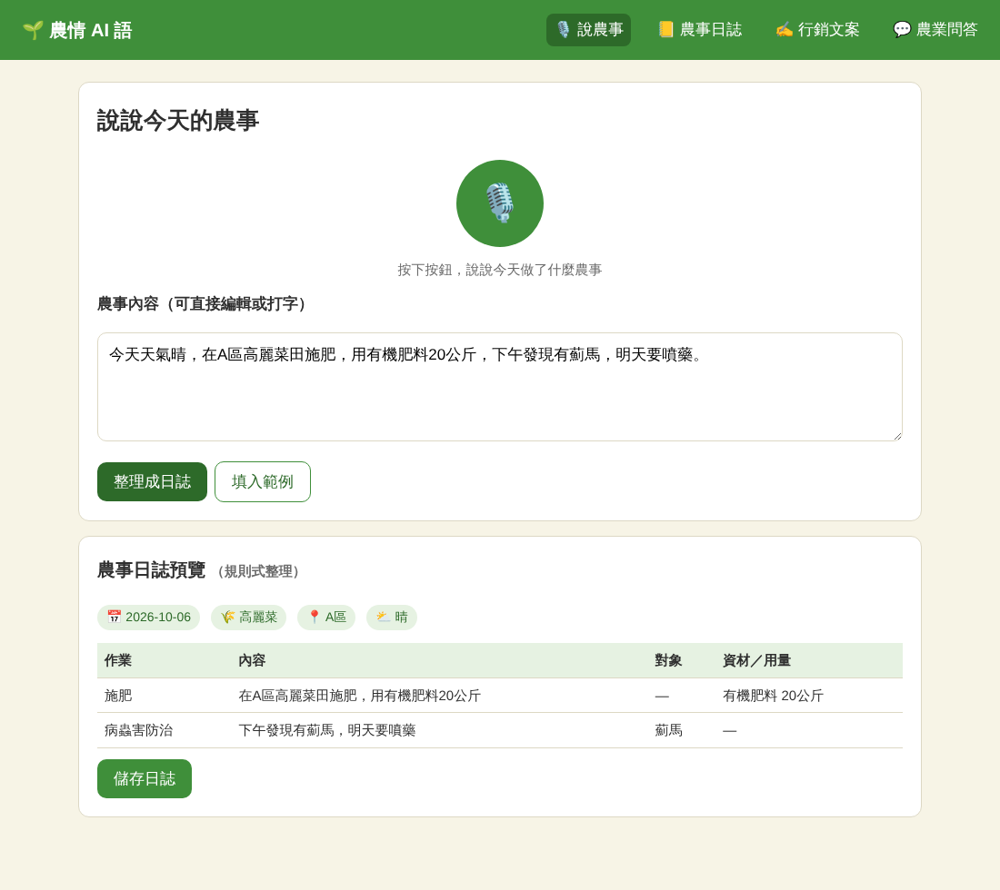
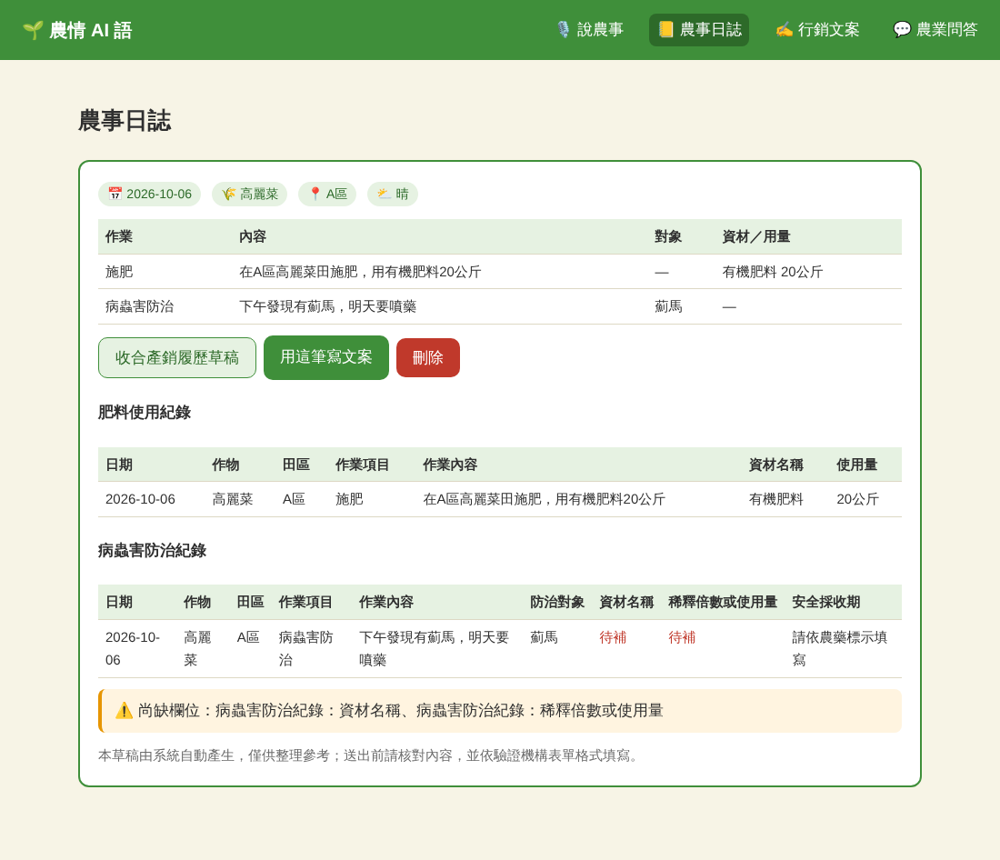
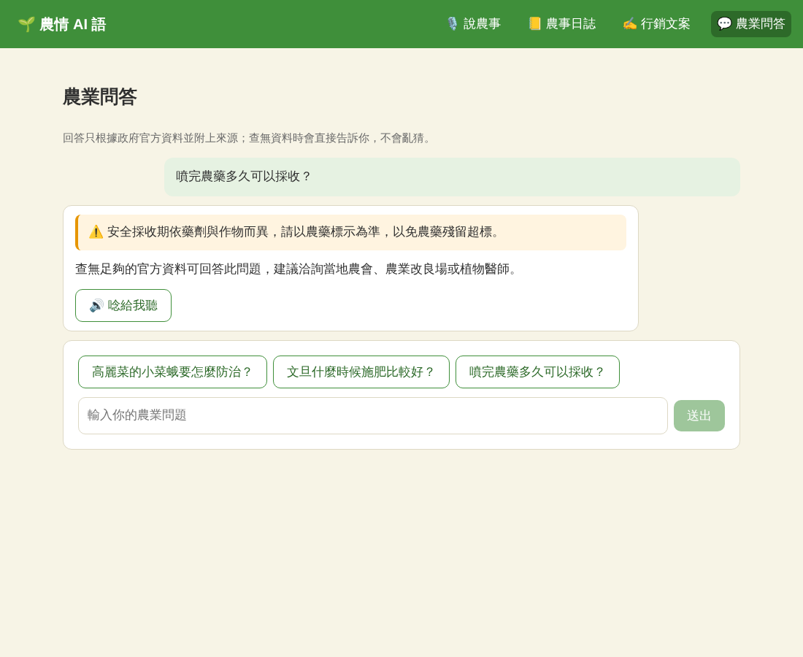

# 結合 Open Data 的智慧農務與品牌文案生成助手

台灣小農普遍高齡、數位經驗有限，卻要面對產銷履歷紀錄要求、行銷農產壓力，加上網路上農業資訊真假混雜。本專案以語音為主要互動方式：農民只要用口語說出當天的農事，系統就會

1. 🎙️ **語音轉成文字**（AWS Transcribe）
2. 🔤 **農業專有詞彙校正**（同音誤字修正，如「碳疽病」→「炭疽病」）
3. 📒 **整理成結構化農事日誌**（作物、田區、作業、資材、用量）
4. 📋 **產生產銷履歷申報草稿**，並標出還缺哪些欄位
5. ✍️ 以**行銷 4P 理論**把同一份紀錄轉成**品牌故事**與**行銷文案**
6. 💬 **農業問答**採 RAG 架構，以 search agent 查詢政府官方資料，回答附上來源；資訊不足或高風險問題（用藥劑量、混藥、中毒）會主動提出安全警示
7. 🔊 回答可用語音播報（AWS Polly）

把「記錄」和「行銷」串成同一個流程。

| 說農事 | 農事日誌與產銷履歷草稿 | 農業問答 |
|---|---|---|
|  |  |  |

## 技術棧

React · Next.js · Flask (Python) · OpenAI API · Firebase · AWS Transcribe · AWS Polly

## 專案結構

```
nongqing-ai/
├── frontend/                 # Next.js 14 (App Router, TypeScript)
│   ├── app/                  # 頁面：首頁、說農事、農事日誌、行銷文案、農業問答
│   ├── components/           # VoiceRecorder、LogDetail、TraceabilityView…
│   └── lib/                  # API client、型別、Firebase
├── backend/                  # Flask API
│   ├── app/
│   │   ├── routes/           # /api/speech、/api/logs、/api/traceability、/api/marketing、/api/qa
│   │   ├── services/         # 語音、詞彙校正、日誌解析、產銷履歷、文案、問答、風險分級
│   │   │   └── rag/          # 本地向量檢索 + 官方網站 search agent
│   │   └── data/
│   │       ├── agri_terms.json   # 農業詞彙表（誤字對照、作物、病蟲害、肥料）
│   │       └── rag/docs/         # RAG 知識庫原始文件（放這裡後執行建索引）
│   ├── scripts/build_index.py
│   └── tests/
└── docs/architecture.md
```

## 快速開始

### 後端

```bash
cd backend
python -m venv .venv && source .venv/bin/activate   # Windows: .venv\Scripts\activate
pip install -r requirements.txt
cp .env.example .env        # 填入需要的金鑰（可全部留空）
python run.py               # http://localhost:5000
```

### 前端

```bash
cd frontend
npm install
cp .env.example .env.local
npm run dev                 # http://localhost:3000
```

### 測試

```bash
cd backend && pytest
```

## 金鑰與離線備援

所有外部服務都是**選用**的，金鑰留空時系統仍可完整操作：

| 服務 | 環境變數 | 未設定時 |
|---|---|---|
| OpenAI | `OPENAI_API_KEY` | 日誌改用規則式解析、文案改用範本、問答直接列出檢索摘要 |
| AWS Transcribe | `AWS_ACCESS_KEY_ID`、`AWS_SECRET_ACCESS_KEY`、`AWS_S3_BUCKET` | 停用錄音辨識，改用文字輸入 |
| AWS Polly | 同上 AWS 憑證 | 停用語音播報 |
| Firebase | `FIREBASE_CREDENTIALS`（service account JSON 路徑） | 日誌存在 `backend/app/data/local_db.json` |
| Google Programmable Search | `GOOGLE_CSE_API_KEY`、`GOOGLE_CSE_ID` | 停用官方網站搜尋 |

首頁的「服務狀態」會顯示目前哪些服務已啟用。

## 建立 RAG 知識庫

1. 將官方資料（農業部、農藥資訊服務網、各區農業改良場等）整理成 `.txt` 或 `.md`，放到 `backend/app/data/rag/docs/`
2. 檔案第一行可寫 `url: https://...` 標註來源網址，回答時會附上連結
3. 執行 `python -m scripts.build_index`（需設定 `OPENAI_API_KEY`）

知識庫為空時，問答會改用 search agent 查詢官方網站；兩者都查不到資料時，系統會直接回覆「資料不足」並建議洽詢農業改良場，不會讓模型自行臆測。

## API

| Method | Path | 說明 |
|---|---|---|
| GET | `/api/health` | 服務狀態 |
| POST | `/api/speech/transcribe` | 上傳音檔（multipart `audio`）→ 文字 + 詞彙校正 |
| POST | `/api/speech/synthesize` | `{text}` → mp3 |
| POST | `/api/logs/parse` | `{text}` → 結構化農事日誌 |
| GET / POST | `/api/logs` | 列出 / 儲存日誌 |
| GET / DELETE | `/api/logs/<id>` | 取得 / 刪除日誌 |
| POST | `/api/traceability/draft` | `{log_id}` → 產銷履歷草稿 |
| POST | `/api/marketing/generate` | `{product, log_ids}` → 4P 分析、品牌故事、文案 |
| POST | `/api/qa/ask` | `{question}` → 回答、來源、風險警示 |

## 注意事項

本專案延伸自2025山城數位黑客松之參賽提案，另做系統平台延伸；
產銷履歷草稿僅供整理參考，正式申報請依驗證機構提供之表單格式填寫；
農業問答不構成用藥建議，農藥使用請以農藥標示及農藥資訊服務網公告為準。
